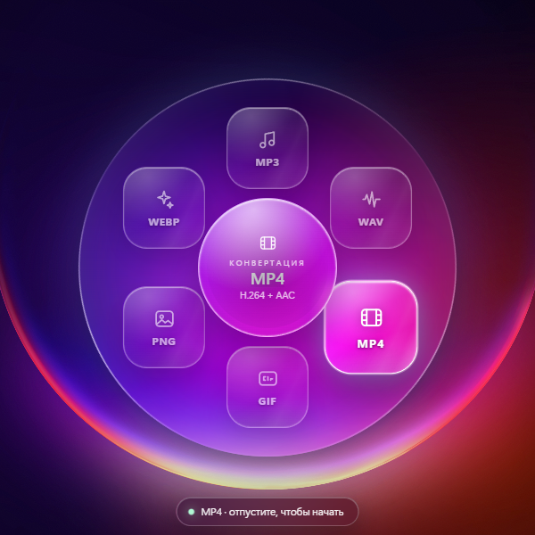
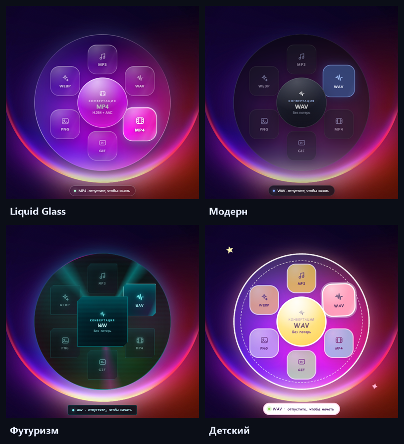
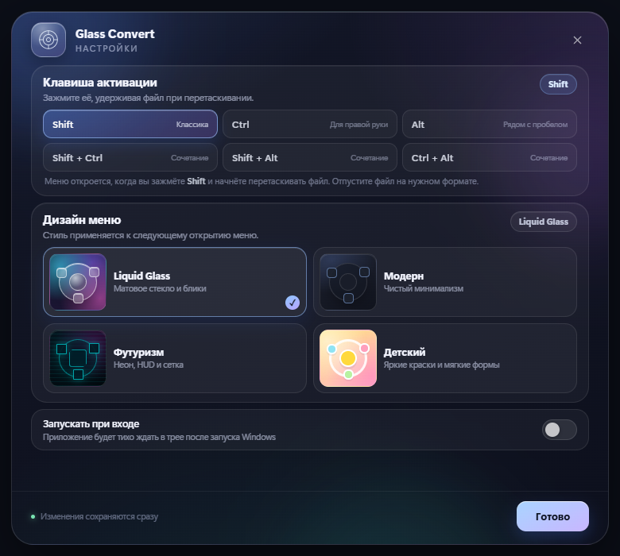
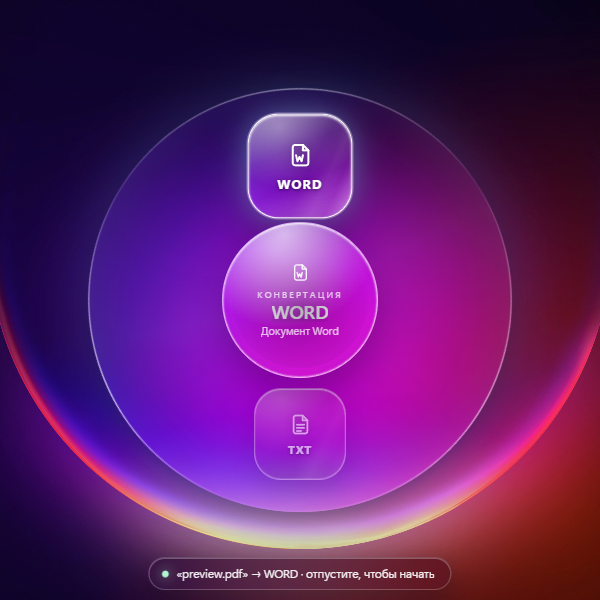
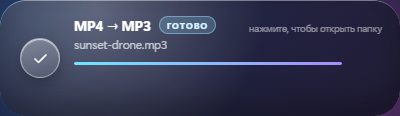

# Glass Convert

[](https://github.com/vxcqt/glass-convert/actions/workflows/build.yml)

Фоновый конвертер для Windows: зажмите выбранную клавишу во время перетаскивания файла — рядом с курсором раскроется радиальное меню. Отпустите файл на нужный формат, и готовая копия появится рядом с исходником.

В версии **1.1.0** клавишу активации можно выбрать в настройках, добавились четыре темы оформления и настоящая конвертация **PDF ↔ Word**.

<p align="center">
  
</p>

<p align="center">
  
</p>

## Скачать

Готовый **portable .exe** для Windows 10/11 x64 лежит в [Releases](https://github.com/vxcqt/glass-convert/releases/latest):

**`GlassConvert-1.1.0-portable.exe`** — просто запустите, установка не нужна. Приложение свернётся в системный трей.

> Файл не подписан цифровой подписью, поэтому SmartScreen может предупредить. Нажмите «Подробнее» → «Выполнить в любом случае».

## Что нового в 1.1.0

- **Настраиваемая клавиша активации:** Shift, Ctrl, Alt, Shift+Ctrl, Shift+Alt или Ctrl+Alt.
- **Четыре темы:** Liquid Glass, «Модерн», «Футуризм» и «Детский».
- **Документы:** PDF → Word/TXT, Word (DOCX) → PDF/TXT, TXT → Word/PDF.
- Отдельное стеклянное окно настроек: клавиша, тема, автозапуск и пауза.
- Улучшенное радиальное меню: документы получают собственную иконку и набор форматов.

## Что умеет

- Живёт в трее, не мешает работе и не открывает лишних окон.
- Ловит **настраиваемую комбинацию + перетаскивание** в Проводнике, на рабочем столе и в других программах.
- Радиальное меню под курсором: список форматов зависит от типа исходного файла.
- Конвертирует аудио/видео через встроенный `ffmpeg` — ничего устанавливать не нужно.
- Работает с PDF и Word без установленного Microsoft Office.
- Показывает прогресс в стеклянном тосте и уведомляет Windows о завершении.
- Кладёт результат **рядом с исходным файлом**, не перезаписывая существующие.
- Поддерживает перетаскивание сразу нескольких файлов.
- Запоминает выбранную клавишу и тему между запусками.

### Форматы

| Исходник | Куда можно конвертировать |
| --- | --- |
| Аудио (wav, flac, ogg, m4a, aac, opus, wma…) | MP3, WAV, FLAC, OGG, M4A |
| Видео (mp4, mkv, mov, avi, webm, wmv…) | MP3, M4A, MP4, WebM, GIF, WAV |
| Изображения (png, jpg, webp, bmp, tiff, heic…) | PNG, JPG, WEBP, GIF, BMP |
| PDF | Word (`docx`), TXT |
| Word (`docx`) | PDF, TXT |
| TXT | Word (`docx`), PDF |

## Как пользоваться

1. Возьмите файл в Проводнике и начните перетаскивать.
2. Не отпуская кнопку мыши, зажмите **выбранную клавишу** (по умолчанию — **Shift**).
3. Рядом с курсором появится радиальное меню. Ведите файл к нужному формату — подсветится кольцо и подсказка.
4. Отпустите файл. Тост покажет прогресс, готовый файл появится рядом с исходным.

> Меню открывается с короткой задержкой (~0,2 с): в этот момент делается снимок фона, чтобы стекло было по-настоящему матовым.

### Клавиша активации

| Вариант | Комбинация |
| --- | --- |
| Shift | Shift + перетаскивание |
| Ctrl | Ctrl + перетаскивание |
| Alt | Alt + перетаскивание |
| Shift + Ctrl | Shift и Ctrl + перетаскивание |
| Shift + Alt | Shift и Alt + перетаскивание |
| Ctrl + Alt | Ctrl и Alt + перетаскивание |

Изменить вариант можно в **Настройках** (иконка в трее → «Настройки…»). Там же выбирается тема интерфейса.

Дополнительно:

- **Ctrl + Alt + Space** или клик по иконке в трее — открыть меню вручную.
- **Esc** — закрыть меню.
- Меню в трее: настройки, пауза, автозапуск при входе, выход.

## Скриншоты

<p align="center">
  
  
</p>

<p align="center">
  
</p>

## Документы: что важно знать

PDF → Word и Word → PDF работают полностью локально, но это не побайтовое сохранение вёрстки:

- **PDF → Word** извлекает текстовый слой через `pdf.js` и собирает из него документ Word: абзацы, размеры шрифта, разрывы страниц. Сложные колонки, таблицы и графика PDF могут упроститься.
- **Сканированные PDF без текстового слоя** не поддерживаются — для них нужен OCR. Приложение сообщит об этом понятной ошибкой.
- **Word → PDF** проходит через HTML (`mammoth`) и печать Electron: заголовки, абзацы, списки, таблицы и встроенные изображения сохраняются, но сложные фигуры и многоколоночная вёрстка могут выглядеть проще.
- Поддерживаются только `.pdf`, `.docx` и `.txt`. Старый `.doc` нужно предварительно сохранить как `.docx`.
- Защищённые паролем PDF и повреждённые файлы обрабатываются с понятным сообщением об ошибке.

## Как это работает

- `main.js` — фоновый процесс: трей, глобальный хук `uiohook-napi`, окна меню и тоста, очередь конвертации.
- Триггер срабатывает, когда выбранные модификаторы зажаты **вместе с левой кнопкой мыши** — то есть именно во время перетаскивания. Одиночное нажатие клавиши меню не открывает.
- `src/overlay.*` — радиальное меню: чистый CSS/JS, glass-эффекты, темы и реакция на угол курсора.
- Перед показом меню `ffmpeg` (gdigrab) делает снимок области под ним (~0,2 с), а CSS размывает его внутри линзы. Поэтому стекло действительно матовое: фон под меню виден, но размыт, а снаружи остаётся резким.
  Снимок живёт только в памяти и никуда не сохраняется. Захват работает для основного монитора; на остальных меню показывает прозрачное стекло без размытия.
- `src/convert.js` — обёртка над `ffmpeg-static` и диспетчер документов.
- `src/convert-docs.js` — PDF/TXT/Word: `pdfjs-dist`, `docx`, `mammoth` и `BrowserWindow.printToPDF`.
- `src/settings.html/css/js` — окно настроек; `src/preferences.js` — общие варианты клавиш и тем.
- `src/toast.*` — стеклянный тост с прогрессом и результатом.
- `src/icon.js` — иконка приложения и трея рисуется кодом (PNG-энкодер без зависимостей).

## Настройки

Хранятся в `%APPDATA%\Glass Convert\settings.json`:

```json
{
  "enabled": true,
  "autoLaunch": false,
  "trigger": "shift",
  "theme": "liquid"
}
```

- `trigger`: `shift`, `ctrl`, `alt`, `shift+ctrl`, `shift+alt`, `ctrl+alt`.
- `theme`: `liquid`, `modern`, `futuristic`, `kids`.
- `enabled`: пауза глобального триггера.
- `autoLaunch`: запуск при входе в Windows.

Менять значения вручную не обязательно — всё доступно в окне настроек и меню трея.

## Сборка

Нужен [Node.js](https://nodejs.org) 22+ и Windows x64.

```bash
npm install
npm run build
```

Готовый portable .exe появится в `dist/`. CI собирает его же на GitHub Actions (`.github/workflows/build.yml`) и складывает в артефакты.

Для разработки:

```bash
npm start
```

Приложение не показывает главное окно: ищите иконку в системном трее. Окно настроек можно открыть из трея.

## Превью интерфейса

```bash
npm run preview
```

Скриншоты складываются в `preview/`. Для README используйте файлы из `docs/`.

## Проверка конвертеров

```bash
node scripts/test-convert.js
npm run test:docs
```

`test-docs` запускается через Electron (так работает `printToPDF`) и проверяет Word → PDF, PDF → Word/TXT, TXT → Word/PDF, а также сохранение разрыва страницы.

## Приватность

Все конвертации выполняются на компьютере. Приложение не отправляет файлы в сеть и не сохраняет снимок экрана на диск. Сетевых запросов у самого приложения нет.

## Лицензия

[MIT](LICENSE)
